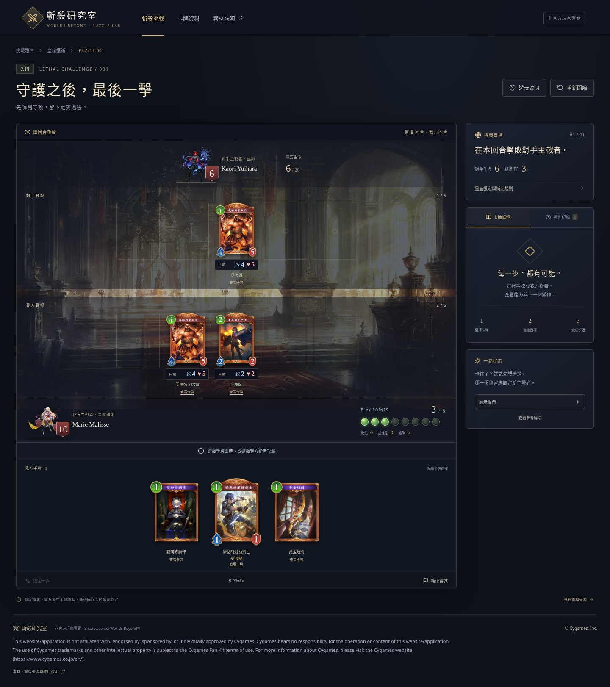

# 斬殺研究室 · Worlds Beyond

React、TypeScript、Vite 製作的非官方斬殺解題原型。使用五張 **真實官方繁中卡牌**、官方 Fan Kit 主戰者及背景。玩家點擊出牌與攻擊，由規則引擎結算，不需要輸入文字答案。

## 直接睇畫面



[選擇目標](screenshots/02-target.jpg) · [斬殺成功與操作紀錄](screenshots/03-success.jpg) · [正式卡牌資料](screenshots/04-cards.jpg) · [手機畫面](screenshots/05-mobile.jpg) · [圖文說明 PDF](screenshots/guide.pdf)

## 下載後直接玩（電腦）

開啟 [preview/play.html](preview/play.html)，按 GitHub 的 **Download raw file／下載**，將 `play.html` 儲存到電腦，再用 Chrome、Edge 或 Firefox 開啟。

這個檔案約 13 MB，包含程式、樣式及所有原始 PNG 素材。**不需要伺服器、Node.js 或 localhost**。已用 Chromium 驗證直接開本機檔案可以載入所有素材及完成斬殺，遊玩時沒有 HTTP 請求。外部官方來源連結仍需網絡。

GitHub 不會直接把 repository 內的 HTML 當網站執行。手機可在這份 README 看截圖；要在手機瀏覽器直接玩，需要另外設定網站部署。本 repo 目前保持 private，沒有公開部署。

## 本機開發

需要 Node.js 24：

```bash
npm ci
npm run dev
```

開啟執行命令的電腦上的 `http://localhost:3000`。若使用雲端環境，必須經由該環境的 port 預覽網址，不能將雲端 localhost 直接當作遠端網址。

```bash
npm test
npm run build
npm run package-preview
```

`package-preview` 重新產生包含圖片的獨立 HTML。部署用檔案在 `dist/`，可以放到支援靜態網站的平台；目前沒有設定外部部署帳戶。

## 第一道題目

**守護之後，最後一擊**：敵方生命 6、守護歌利亞 4/5；我方生命 10、剩餘 3/8 PP，場上歌利亞 4/5 與劍鬥士 2/2 均可攻擊。手牌三張：雙向的調律、瞬息的迅捷劍士、黃金短劍。

| 正式卡牌 | 官方 ID | 費用 | 本題相關能力 |
| --- | --- | --- | --- |
| 威撼的歌利亞 | 10001130 | 4 | 4/5、守護 |
| 不屈的劍鬥士 | 10001110 | 2 | 2/2；已有場上從者，尚未攻擊 |
| 瞬息的迅捷劍士 | 10021110 | 1 | 1/1、疾馳 |
| 雙向的調律 | 10721310 | 1 | 指定敵方從者造成 3 點傷害 |
| 黃金短劍 | 90021310 | 1 | 指定敵方從者或主戰者造成 1 點傷害 |

完整能力保存在卡牌資料。協作起始為 6，召喚迅捷劍士後為 7，故調律的協作 10 效果不觸發。進化與超進化點均為 0。黃金短劍是上一回合取得的衍生卡。沒有隨機、抽牌、徽章或其他隱藏效果；固定盤面停在本回合，不模擬下一回合。

## 已完成

- 點選法術及目標、召喚從者、選擇攻擊目標。
- PP、守護、疾馳、普通從者進場等待、單次攻擊、同時戰鬥傷害、死亡移除及勝負判定。
- 規則按結果判定，容許不同正確操作次序。
- 目前數值、有效目標高亮、傷害回饋、成功畫面。
- 重新開始、退回一步、操作紀錄、分段提示、參考解法。
- 卡牌資料及素材來源彈窗、鍵盤關閉、手機觸控布局。
- 完成紀錄保存在瀏覽器；盤面進度只保存在當前頁面記憶體。

卡面保留原始數值；戰場下方「目前」數值會隨傷害更新。

## 程式結構

```text
src/App.tsx                  React 操作流程與盤面
src/components/              卡牌與彈窗元件
src/engine/game.ts           獨立規則引擎
src/data/cards.json          選定官方卡牌的顯示資料
src/data/puzzle.ts           固定題目、條件與解法
src/styles.css               奇幻風格及手機布局
public/assets/               本地卡牌、主戰者、背景
public/data/                 原始資料快照及逐檔素材來源
scripts/package-preview.mjs  打包本機可直接開啟的預覽
preview/play.html            已打包的獨立預覽
screenshots/                 實際畫面及 PDF
```

## 驗證

13 項規則測試通過，含不同解法、非法目標、PP、守護、同時傷害、疾馳、重複攻擊、爆能強化、協作及完整合法操作樹遍歷。TypeScript 檢查及正式 build 通過。

Chromium 流程測試驗證素材載入、合法斬殺、非法攻擊、撤回、重置、卡牌資料、來源頁、彈窗鍵盤操作、390px 手機互動及失敗嘗試；沒有頁面 JavaScript 錯誤。獨立 HTML 亦完成一個不同次序的斬殺流程。

## 範圍及來源

只有一道固定題及有限卡池，不是完整遊戲引擎；沒有登入、公開題庫或玩家自由出題。原始文字出題版保留於 Git 歷史的首個 commit。

遊戲素材 **© Cygames, Inc.**；本站與 Cygames 沒有官方關係。主戰者及背景取自官方 Fan Kit，卡牌資料及圖片取自官方 Card Library。逐檔原始網址、日期、版權標示、條款狀態及 SHA-256 見 [ASSET_SOURCES.md](ASSET_SOURCES.md)。卡牌圖片的獨立再使用授權未核實，公開營運前須確認。

下一階段可以在這個規則引擎上擴充已驗證卡池，再加入玩家出題及題目分享。
