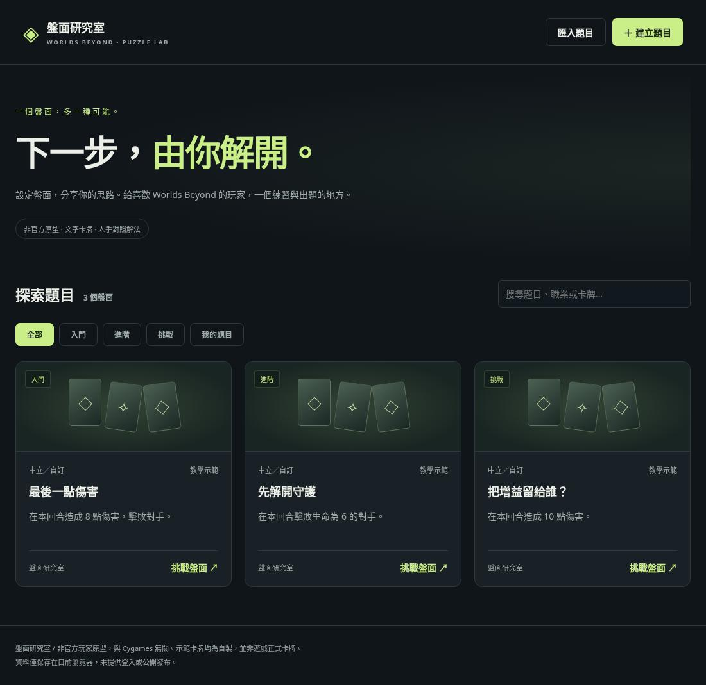
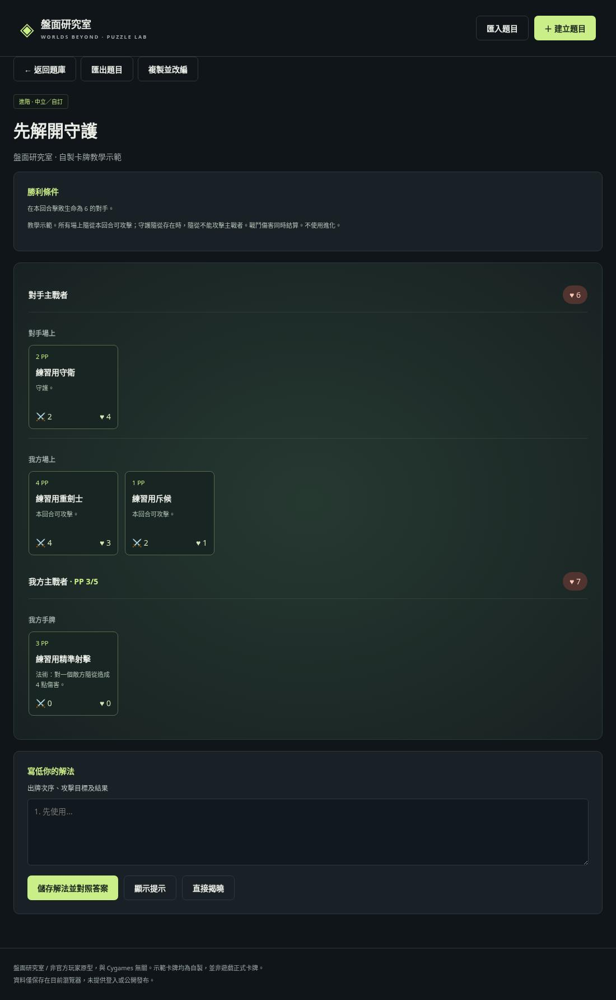
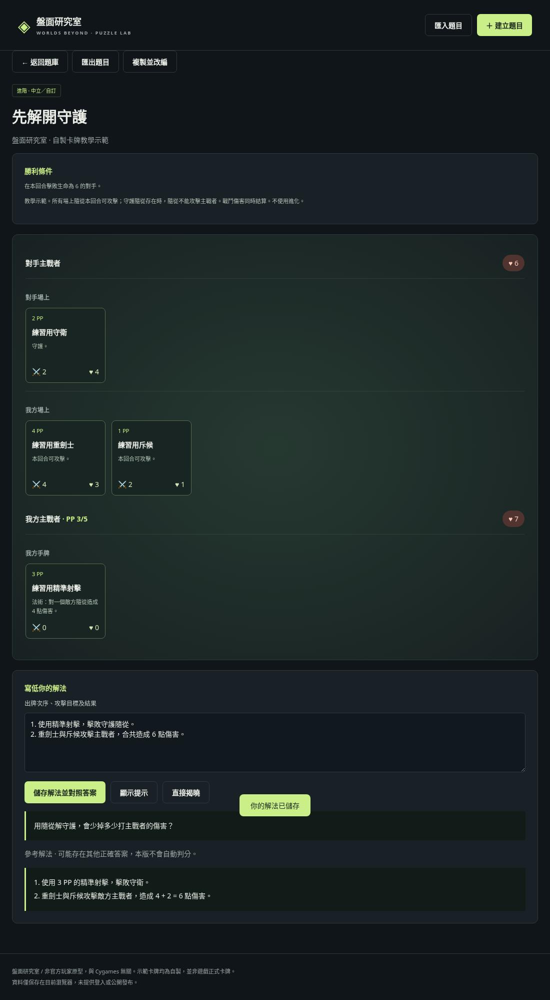
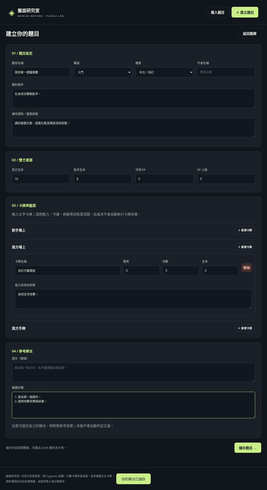

# 盤面研究室

Worlds Beyond 玩家出題及文字解題原型。原生 HTML/CSS/JavaScript，無需安裝依賴。

## 畫面預覽









[下載圖文說明 PDF](screenshots/guide.pdf)

## 開啟

```bash
cd /workspace/shadowverse-puzzles
python3 -m http.server 3000 --bind 0.0.0.0
```

瀏覽 `http://localhost:3000`，或使用環境提供的 3000 port 預覽。

## 功能

- 3 道自製卡牌示範題、搜尋、難度及本機題目篩選。
- 建立／編輯／刪除題目；雙方生命、PP、三個卡牌區域、提示、參考解法。
- 提交文字解法，保存後對照答案；不自動判分。
- JSON 匯入／匯出，可傳送檔案分享題目。
- 題目及解法保存在目前瀏覽器的 localStorage，清除瀏覽器資料會刪除記錄。請匯出備份。

## 程式結構

- `index.html`：畫面及出題表單。
- `style.css`：深色介面及手機版配置。
- `app.js`：資料驗證、題庫、盤面呈現、出題、解法及 JSON 交換。

每道題目是一個物件：`title`、`difficulty`、`craft`、`goal`、`notes`、雙方生命及 PP，另有 `enemy`（對手場上）、`player`（我方場上）、`hand`（手牌）三個卡牌陣列。卡牌包含名稱、費用、攻擊、生命、文字能力。法術與護符可將攻擊及生命設為 0。

## 原型範圍

沒有帳戶、伺服器資料庫、公開發布或完整遊戲規則引擎。參考答案存在客戶端，適合練習，不適合防作弊比賽。示範題使用虛構卡牌；没有整合正式卡池、官方圖片或牌面效果。這是非官方原型，與 Cygames 無關。

下一階段可加入帳戶與資料庫、真正卡牌資料、盤面狀態欄位，最後再按需求實作有限卡池的操作及判分。正式卡牌資料與圖片須先確認來源及使用權。

## 驗證

已通過 JavaScript 語法檢查及 Chromium 瀏覽器流程測試：建立、編輯、卡牌輸入、本機儲存、JSON 匯出再匯入、解法揭曉、PP 上限驗證，以及 390px 手機闊度無橫向溢出。測試過程未有頁面 JavaScript 錯誤。
